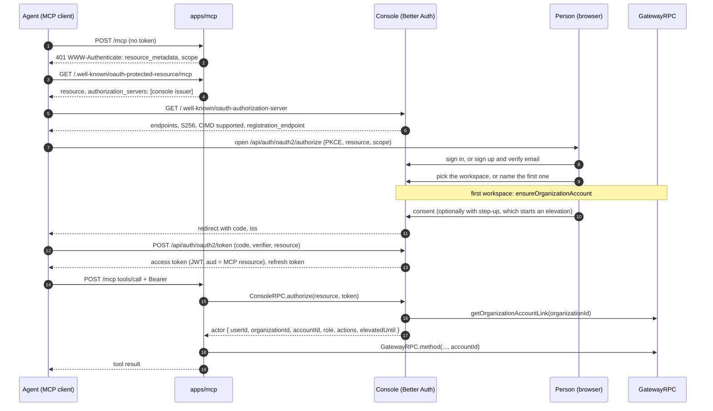

# Design: MCP server for agent-driven onboarding and management

Verified against primary sources on 2026-11-23; versions and URLs are in
[research.md](./research.md). The integration points the first draft could only read about were run
in spike 0.3 on 2026-11-23; § 8 records each answer with its evidence, and the sections below
already state the result. What still needs a hosted client or a deployment is listed in § 8.3.

## 1. Context the design must respect

Read from the repository at `3855943`:

- **Two planes, one authority each** (`docs/auth-tenancy-contract.md` §2). Better Auth on the auth
  D1 answers who is signed in and what role they hold; the `EccosControlPlane` Durable Object
  answers which account, WABAs, phones and keys exist. Neither answers the other's question.
- **Authorization is re-derived on every request** (§1, §5): session → membership →
  `organization_accounts` → account → WABA ownership. "No long-lived role claims (JWTs or
  otherwise) are ever trusted across requests", and a revoked membership takes effect on the next
  request.
- **One customer origin** (§6). The console answers only the `BETTER_AUTH_URL` host and accepts
  no credentials cross-origin.
- **The gateway's operator API is never public HTTP.** The console reaches it through the
  `GatewayRPC` service binding, passing an `accountId` it resolved itself.
- **Role matrix** (§4, `apps/dashboard/src/auth/permissions.ts`): `view` (viewer+), `operate`
  (operator+), `configure` and `administer` (admin+), `erase` (owner). Admin-class writes require
  TOTP and a sign-in within 15 minutes. That enforcement is PR #78, which is still open; today the
  policy is configured and not enforced.
- **The connection link already exists.** An admin mints a 7-day, single-use link bound to
  (account, creating user); whoever opens `/connect#<token>` runs Embedded Signup into that
  workspace with no Eccos session, in Spanish or English. This is exactly the hand-off an agent
  needs, and it is already audited and rate-limited.
- **Billing** (`apps/dashboard/src/billing`): Creem, priced per connected number. An account whose
  connect policy is `closed` cannot add numbers (`subscription_required`) but keeps sending.
- **Gaps in the gateway.** It only *reads* phone numbers from Meta. Nothing calls
  `POST /{waba}/phone_numbers`, `request_code`, `verify_code`, `register`, the two-step PIN,
  the display name or the business profile. Broadcasts and scheduled sends can be created only
  over public `/v1` with an API key; `GatewayRPC` reads and cancels them.

What changed upstream since the Captain's first sketch, and why it matters:

- **MCP is stateless as of revision 2026-07-28.** No `initialize`, no session id, no GET stream.
  Server-initiated requests became multi-round-trip results.
- **Cloudflare deprecated `McpAgent`** (the Durable Object per session) in `agents` 0.20.0. The
  recommended server is `createMcpHandler` from `agents/mcp/server` with MCP SDK v2: a fresh
  server per request, no Durable Object.
- **`@cloudflare/workers-oauth-provider` 1.x split into an authorization server and a resource
  server.** `OAuthResourceServer` takes a `validateToken` function, publishes RFC 9728 metadata
  and builds the Bearer challenges. Cloudflare's own split topology has the resource Worker call
  the authorization Worker over a service binding to validate a token.
- **The spec has a native way to send a person to a URL.** URL-mode elicitation: a tool returns
  `input_required` with a URL, the client shows it, and retries the same call. MCP SDK 2.4.0
  ships it as `inputRequired.elicitUrl`. Clients must declare support, and 2025-era clients
  cannot receive it through the stateless handler.
- **Dynamic Client Registration is deprecated in the MCP spec** in favour of Client ID Metadata
  Documents (CIMD). Claude and ChatGPT support both; Cursor documents DCR.
- **Better Auth removed `oidcProvider` and the old in-tree `mcp` plugin in 1.7.0.** The current
  packages are `@better-auth/oauth-provider`, `@better-auth/mcp` and `@better-auth/cimd`, which
  require `better-auth` ^1.7.27. The repository pins 1.7.14.

## 2. Architecture


### 2.1 Components

**`apps/mcp` (new Worker).** A Hono app, like the gateway, with one job: speak MCP.

- `OAuthResourceServer` from `@cloudflare/workers-oauth-provider` hosts the resource
  `https://mcp.eccos.chat/mcp`. It serves `/.well-known/oauth-protected-resource/mcp`, answers a
  request without a valid token with `401` and a `WWW-Authenticate` challenge that carries
  `resource_metadata` and the scopes to ask for, and refuses a token whose audience is not this
  resource.
- Its `validateToken` is one call: `env.CONSOLE.authorize(resource, token)`. The MCP Worker never
  holds a signing key, never fetches a JWKS and never parses a claim it then trusts.
- `createMcpHandler` from `agents/mcp/server` serves Streamable HTTP at `/mcp`, stateless, with
  `legacy: "stateless"` so 2025-era clients work. There is no `/sse`, no Durable Object and no
  KV. The server factory registers only the tools the caller's effective permissions allow.
- Tools are plain functions of `(input, actor, deps)`. `deps.for(action)` hands out
  `{ gateway, console }` carrying only the `GatewayApi` and `ConsoleApi` methods that
  `src/permissions.ts` binds to that action (the console's own gating for each), typed and built
  that way, and only for an action the actor holds; otherwise it throws a tool error naming the
  role or the scope that is missing. A method the table leaves out is reachable by no tool.
  `deps.can(action)` asks first. A tool asks for the action each call needs, so a call the console cannot gate (an
  `ActorRef` carries no scope) never leaves this Worker. Tools never see the token.
- Bindings: `GATEWAY` (entrypoint `GatewayRPC`), `CONSOLE` (entrypoint `ConsoleRPC`), one Rate
  Limiting binding. Vars: its own public origin, the issuer URL, the console origin. One secret,
  `REQUEST_STATE_KEY` (set with `wrangler secret put`, at least 32 bytes): the HMAC key that
  seals the step-up guard's URL-elicitation `requestState` to { request id, tool } and the grant.
  It grants no access, since elevation is always re-read from the console; unset, the guard
  never uses URL elicitation and every client gets the structured approval result. A key shorter
  than 32 bytes counts as unset, and one error line per isolate says so, never with the value.
  A state the SDK refuses as forged or expired writes an audit line (`denied`,
  `invalid_request_state`).

**`apps/dashboard` (existing Worker) gains the authorization server.**

- Plugins: `jwt({ disableSettingJwtHeader: true })` with `disabledPaths: ["/token"]`,
  `mcp({ resource, loginPage, consentPage, postLogin, ... })` from `@better-auth/mcp`, and
  `cimd()`. `mcp()` *is* the OAuth provider; `oauthProvider()` is not registered next to it.
  `resourceSeedScope: "process"` because the auth instance is built per request.
- Issuer: the bare console origin, `https://app.eccos.chat` (`jwt({ jwt: { issuer } })`). The
  endpoints under `/api/auth/oauth2/*` and `/api/auth/jwks` are already reached by the existing
  `/api/auth/*` dispatch. The RFC 8414 document lives at the root,
  `/.well-known/oauth-authorization-server`, which `src/server.ts` serves explicitly before the
  page gate. Claude and ChatGPT document only the root paths, and with an issuer of
  `/api/auth` the root answered `406` (§ 8.2).
- Pages: the existing sign-in and sign-up, a workspace step (pick one, or create the first), and
  a consent page; an approval page for elevation (§3.3) and a claim page for secrets (§3.6).
  Settings gains "Connected agents": the grants on this workspace, whether each is elevated and
  until when, End elevated access, and Revoke.
- `ConsoleRPC`, a `WorkerEntrypoint` exported from `src/server.ts` next to the default export.
  The TanStack Start build keeps the named export and a service binding reaches it (§ 8.1).

**`packages/console-contract` (new).** The `ConsoleApi` interface and its types, mirroring
`packages/gateway-contract`.

**`apps/gateway`.** Gains secret claims in phase 1 (§3.6) and is otherwise unchanged until
phase 3. `apps/mcp` becomes its second trusted caller.

### 2.2 `ConsoleApi`

The contract is `packages/console-contract`; this is its shape. Every refusal is a value with a
`code`, never a thrown error, because an error crossing Workers RPC keeps only its message. The
grant can end between `authorize` and a later call, so every method can answer a grant refusal.

```ts
interface ConsoleApi {
  /** Verify the token for this resource and re-derive everything else. Called on every MCP request. */
  authorize(resource: string, token: string): Promise<AuthorizeResult>;
  /** Open (or return the pending) approval request for this grant. */
  requestElevation(actor: ActorRef, tool: string): Promise<ElevationResult>;
  /** Admin or owner only, as in the console. */
  getBilling(actor: ActorRef): Promise<BillingResult>;
  /** A checkout, or the portal while a subscription exists. Admin or owner. */
  startCheckout(actor: ActorRef): Promise<BillingLink>;
  openBillingPortal(actor: ActorRef): Promise<BillingLink>;
  // phase 4: members and invitations
}

type GrantRefusalCode = "revoked" | "not_a_member" | "no_account";

type AuthorizeResult =
  | { ok: true; actor: Actor; audience: string; expiresAt: number; scope: string[] }
  | { ok: false; code: "invalid_token" | GrantRefusalCode };

type ElevationResult =
  | { ok: true; request: { requestId: string; url: string; expiresAt: number } }
  | { ok: false; code: GrantRefusalCode | "forbidden" };

type BillingResult =
  | { ok: true; billing: BillingState }
  | { ok: false; code: GrantRefusalCode | "forbidden" | "billing_disabled" };

type BillingLink =
  | { ok: true; kind: "checkout" | "portal"; url: string }
  | { ok: false; code: GrantRefusalCode | "forbidden" | "billing_disabled" | "no_billing_account" };

/** The baseline's actions without erase, plus send (granted only by eccos:send). */
type AgentAction = Exclude<GatewayAction, "erase"> | "send";

interface Actor {
  userId: string;
  organizationId: string;
  accountId: string;
  /** The live role, read on this request; the auth baseline's role names. */
  role: MemberRole;
  /** Role actions ∩ scope actions. */
  actions: AgentAction[];
  /** Epoch ms, or null. Null unless the elevation was live when authorize ran; never a lapsed one.
   *  Step-up tools still compare it against their own clock. */
  elevatedUntil: number | null;
  clientId: string;
}

/** Names the grant for a later call. Not evidence of a role: the console re-reads what it needs. */
type ActorRef = Pick<Actor, "userId" | "organizationId" | "accountId" | "clientId">;
```

`authorize` does, in order, on every MCP request:

1. Verify the JWT in process with the auth instance's own keys: signature, `iss`, `aud` equal to
   the resource, `exp`, `typ: at+jwt`, `azp` present. No network call and no key cache to go
   stale: `auth.api.getJwks()` read in process, then `jose`'s `createLocalJWKSet` and
   `jwtVerify`. This uses only public APIs; the internal helper
   (`@better-auth/oauth-provider/internal`) gives the same answers and is not used (§ 8.1).
2. Confirm the grant is still alive: the consent row for (user, client, workspace) exists. Revoking
   in "Connected agents" deletes it **and revokes the grant's refresh tokens**, so revocation takes
   effect on the next request rather than at token expiry. Deleting the consent row alone does not
   stop refresh: the spike refreshed successfully after it (§ 8.1).
3. Re-read membership of the workspace named in the token and the member's **current** role. Not
   a member: refuse.
4. Resolve `organization_accounts` through `GatewayRPC.getOrganizationAccountLink`. Anything but
   `active`: refuse.
5. Read the grant's elevation, if any (§3.3), and report it only while it is live.
6. Return the actor with `actions = roleActions(role) ∩ scopeActions(scope)`.

The refusal codes stay inside Eccos. The MCP Worker maps every refusal to the same `401` challenge, so a
token holder learns nothing about why.

### 2.3 Why this shape

**The token is a pointer, never evidence.** The contract forbids trusting role claims across
requests. A self-contained JWT validated at the edge of `apps/mcp` would carry a role for its
whole lifetime and could not be revoked before expiry. Asking the identity plane on each request
costs one RPC and a few D1 reads, which is what every console request already pays, and it makes
an agent's request go through the same six steps as a browser's (contract §1). Nothing about
authorization is cached in `apps/mcp`.

**Resource server and authorization server are different Workers on different hosts.** The
console's origin policy stays exactly as written: one host, cookies, no cross-origin credentials.
The MCP endpoint is the opposite kind of surface (bearer only, CORS-enabled, called by software),
and on its own hostname a browser never sends it an Eccos cookie, so there is no path by which a
session could authenticate an MCP call by accident.

**The MCP stack is isolated from the console.** Cloudflare ships `agents` roughly weekly and the
MCP SDK is on its second major version. Upgrades, rollbacks and rate limits for the agent surface
do not touch the console's bundle or its tests. Self-hosters who do not want it do not deploy it.

**Tools depend on two interfaces, not on a placement.** `GatewayApi` and `ConsoleApi` are the
whole dependency of the tool layer. Where the handler is mounted is a deployment detail that can
change without touching a tool.

**No state in the MCP layer.** Onboarding state already lives where it belongs: the connection
link and provisioning status in the control plane, the subscription at Creem. A tool that needs to
continue something takes an explicit handle (a `wabaId`, a template name), which is also what the
2026-07-28 spec prescribes in place of sessions.

### 2.4 Alternatives rejected

| Alternative | Why not |
|---|---|
| **Mount `/mcp` inside the console Worker.** | The least code: no new Worker, no `ConsoleRPC`, `requireMcpAuth` in process. Rejected because it puts a CORS-enabled bearer API on the cookie origin and amends §6's one-origin rule, couples console deploys to a fast-moving dependency, and lets tools reach into console internals instead of a declared interface. It remains a valid fallback: the tool layer would move unchanged. |
| **Put the MCP server in the gateway Worker.** | The gateway has no identity plane. It would have to learn users, roles and organizations, which is the coupling the two-plane split exists to prevent. |
| **`McpAgent` on a Durable Object.** | Deprecated and feature-frozen upstream, tied to MCP SDK v1 and protocol sessions the current spec removed. Nothing here needs a session. |
| **`apps/mcp` verifies the JWT itself against the console's JWKS and trusts its claims.** | The documented Better Auth path for a separate resource server (`createMcpProtectedRequestHandler`). Rejected because a role or workspace claim would be trusted for the token's lifetime, a revoked grant or membership would keep working until expiry, and it needs an HTTP fetch of the JWKS between two Workers on the same zone. It is the fallback if `ConsoleRPC` proves unworkable, with a 5-minute token lifetime. |
| **`apps/mcp` binds the auth D1 directly.** | Two Workers owning one identity store, and membership logic implemented twice. |
| **`OAuthAuthorizationServer` from Cloudflare as the issuer**, with Better Auth only as the upstream login. | A second token store in KV and a second consent model next to the one that already knows organizations. The owner asked for Better Auth as the issuer, and it supports everything the MCP profile needs. |
| **Account API keys as the MCP credential.** | The Captain's first sketch. Rejected by the owner; a key has no user, no role and no consent, and cannot be told apart per agent. |
| **Better Auth `agent-auth`.** | A different protocol (not OAuth) at 0.6.2 that its own docs call unstable. MCP clients speak OAuth. |

## 3. Authorization flow



### 3.1 What a token means

A token says: *this client may act as this user in this one workspace, within these scopes*.

- **One workspace per grant.** The post-login step stores the chosen workspace as the consent's
  reference id (`postLogin.consentReferenceId`), and `customAccessTokenClaims` copies it into the
  token. To work in another workspace, the agent connects again and the person picks it. No tool
  takes an organization or account id, so there is nothing to confuse.
- **Never more than the person.** Effective actions are the intersection of the live role and the
  granted scopes. A viewer who grants `eccos:administer` gets a token that can view.
- **Refused at issuance too.** `customAccessTokenClaims` throws when the user is no longer a
  member, which also ends refresh.

### 3.2 Scopes

Scopes mirror the role matrix, so there is one permission model to reason about, plus one scope
for the action that spends the customer's money with Meta and reaches real people.

| Scope | Allows | Role needed |
|---|---|---|
| `eccos:view` | Read status, numbers, templates, logs | viewer |
| `eccos:operate` | Retry deliveries, cancel broadcasts and scheduled sends, read the webhook config | operator |
| `eccos:send` | Send messages: test templates, text, broadcasts, scheduled sends | operator |
| `eccos:configure` | Templates, webhook config, resubscribe, re-check a number, phone settings | admin |
| `eccos:administer` | Connection link, API keys, billing state and checkout, export | admin |
| `offline_access` | A refresh token | any |

There is no scope for `erase`. The server advertises all of them, so one consent covers
everything the person's role allows, and the consent page lets the person untick what they do not
want to delegate. A grant is long-lived: access tokens last 10 minutes and the refresh token
slides for 30 days. Nothing in a grant expires early.

A scope says what a grant may *ever* do. It is not what protects the sensitive actions; elevation
is. A tool whose scope the person unticked answers with the MCP scope challenge (`403`,
`insufficient_scope`), and the client runs the authorization again for the union.

### 3.3 Elevation: admin rights work like sudo

The contract requires TOTP and a sign-in within 15 minutes for a set of console actions (§4,
"MFA / step-up: Yes"). An agent cannot type a TOTP code and should not hold one, and a grant that
loses its admin scopes every day would interrupt work that has nothing to do with them. So the
two are separated, the way `sudo` separates a login from a privileged command:

- The **grant** is long-lived and is never touched by privilege expiry.
- **Step-up tools** are the tools behind those contract rows, and only those: `webhook_set`,
  `webhook_resubscribe`, `api_key_create`, `api_key_revoke`, `connect_link_create`, and later
  `number_set_pin`, `member_invite` and `export_start`. Templates, sends, retries and every read
  are not step-up tools, exactly as in the console.
- A step-up tool runs only while the grant holds a live **elevation**: a row in the auth D1 for
  (user, client, workspace) with an expiry 24 hours after a person approved it. It is not in the
  token, so no token is re-issued when it starts or ends. It lapses silently, and only step-up
  tools notice.

**Getting an elevation.** There are two ways, and both end in the same row.

1. *At consent.* The consent page offers "Also allow sensitive actions for 24 hours". Accepting it
   requires the step-up (re-enter password if the sign-in is older than 15 minutes, then TOTP) in
   that same visit. An onboarding run therefore needs one approval, not two. Declining it does not
   block the grant.
2. *On demand.* When a step-up tool is called without a live elevation, the server calls
   `ConsoleRPC.requestElevation`, which opens an approval request (or returns the pending one for
   this grant) and yields one URL on the console. The person opens it, signs in as the grant's
   user, passes the step-up, sees which agent and which tool asked, and approves. The agent calls
   the same tool again with the same arguments and it runs.

The approval URL is a pointer, not a capability: approving requires the signed-in session of the
grant's own user, who must still be an owner or admin, the same rule as invitation links
(contract §7). A request expires after 10 minutes.

**How the agent is told.** One semantic, two carriers, chosen per request from what the client
declares:

- *URL-mode elicitation*, when the client declares `elicitation.url`. The tool returns
  `inputRequired` with `inputRequired.elicitUrl({ url, message })` and seals the request id into
  `requestState`. The client shows the host and asks the person before opening it, then retries
  the call. On the retry the server reads the elevation again: present, the tool runs; absent, it
  answers with the structured result below rather than a second prompt. A decline or cancel ends
  the call with `elevation_declined`.
- *A structured tool result*, for every other client, including all 2025-era ones:

  ```json
  {
    "status": "approval_required",
    "reason": "elevation_required",
    "message": "A person must approve sensitive actions for this agent. Ask them to open the link, then call api_key_create again with the same arguments.",
    "approvalUrl": "https://app.eccos.chat/agents/approve?request=...",
    "expiresAt": "2026-11-23T12:10:00Z",
    "retry": { "tool": "api_key_create", "when": "after_approval", "sameArguments": true }
  }
  ```

  It is returned with `isError: true` so no client mistakes it for success, and every step-up
  tool's output schema is the union of its success shape and this one. The same JSON is also the
  text block, because Claude Code and Cursor give the model only the text of an error result,
  while Codex forwards only `structuredContent` (§ 8.2). Cursor validates `structuredContent`
  against `outputSchema` even on errors and fails the call when it does not match, so the rule
  for every tool is: an error result either matches the tool's output schema or carries no
  structured content. `workspace_get` reports `elevatedUntil`, so an agent
  can also check before it starts a batch of sensitive work.

The spec says URL-mode elicitation "is not for authorizing the MCP client's access to the MCP
server". Elevation is read as falling on the permitted side of that line: the client's token and
scopes do not change, and what the URL collects is the person's re-authentication, which must not
pass through the client. The round trip works with the MCP SDK client (§ 8.1); which hosted
clients declare URL mode is still open (§ 8.3). If URL mode fails anywhere, the structured result
is already the complete path and nothing else changes.

**Ending it.** An elevation ends at its expiry, when the grant is revoked, or when the person ends
it under Connected agents. A demotion needs no handling: the live role check already refuses.

This depends on PR #78 (TOTP and step-up enforcement in the console). Step-up tools do not ship
before it is merged, or the agent path would be the weaker one.

### 3.4 Client registration

Advertise both mechanisms, so that current and older clients connect:

- **CIMD** (`client_id_metadata_document_supported: true`, `none` among the token endpoint auth
  methods, `S256`). Claude and ChatGPT prefer it. Better Auth's `cimd()` requires an injected
  fetcher and ships one only for Node; its docs ask for DNS pinning that Workers cannot do. A
  Worker has no private network to be rebound into, so the Workers fetcher is: HTTPS only, the
  `global_fetch_strictly_public` compatibility flag on the console Worker, `GET` only, no
  redirects, a size and time cap. Claude's and Claude Code's published documents resolve through
  it; ChatGPT's answered `403` to the local runtime (§ 8.3). Nothing is cached, so each
  authorization fetches the document again (about 90 ms).
- **DCR** (`allowDynamicClientRegistration` with unauthenticated registration) as the fallback
  that Cursor and 2025-era clients need. Registered clients never skip consent, are rate-limited per address, and unused ones are deleted.

The consent page shows the client's name **and the host of its redirect URI**, because under both
mechanisms the name is chosen by whoever registered.

Better Auth's client administration endpoints (`/oauth2/create-client`, `/oauth2/get-clients`,
`/admin/oauth2/*`) have no caller in Eccos and are refused before dispatch, the same way the
organization endpoints are in `src/auth/blocked-endpoints.ts`.

### 3.5 A brand-new customer

There is no tool to sign up, because an MCP tool call needs a token and a token needs a user. The
authorization flow *is* the sign-up:

1. The person adds `https://mcp.eccos.chat/mcp` to their agent. The agent gets a `401`, discovers
   the console and opens the authorize URL.
2. No session: the sign-in page, with sign-up one click away (`signup.page`). They sign up and
   verify their email as today. The sign-up page sets the verification link's `callbackURL` to
   the pending authorization (the signed authorize URL), so the link returns them to it; sending
   the signed query with sign-up alone does not, and the person lands on `/onboarding` (§ 8.1).
   The signed query lives 10 minutes; when it has expired, the agent simply connects again and
   the now-signed-in person lands on the next step. Sign-in and sign-up use Better Auth's
   `oauthProviderClient` and follow the `url` it returns, or the authorization is dropped.
3. No workspace: the post-login step is the existing onboarding form. Creating the workspace runs
   the existing `createOrganization` path, including `ensureOrganizationAccount`. No API key is
   issued, as the contract requires.
4. Consent, with the option to allow sensitive actions for 24 hours in the same visit, then the
   agent holds a token for that workspace.

From there the agent drives: `workspace_get` reports what is missing, `billing_checkout_link`
returns the Creem URL when a subscription is required, `connect_link_create` returns the
Embedded Signup link (a step-up tool, already covered when elevation was given at consent), `connect_status` and `numbers_list` follow provisioning, and the rest of
phase 1 finishes the setup.

The contract's §7 describes sign-up as invite-only for the initial release. No allowlist exists in
the code today and Eccos Cloud has been open to paying customers since 2026-11-12, so this design
assumes open, email-verified sign-up.

### 3.6 Secrets do not pass through the model

A tool that mints a secret returns a **claim** instead of the secret. Today that is two tools:
`api_key_create`, and `webhook_set` when it is asked to generate the signing secret.

**What the tool returns.**

```json
{
  "status": "claim_ready",
  "message": "The API key has not been shown to you. Run the command to write it where it belongs, or give the link to a person. The claim works once and expires in 10 minutes; until it is claimed, no key exists.",
  "claimUrl": "https://app.eccos.chat/claim#<token>",
  "command": "printf 'ECCOS_API_KEY=%s\\n' \"$(curl -fsS -X POST https://app.eccos.chat/api/claim -d token=<token>)\" >> .env",
  "expiresAt": "2026-11-23T12:10:00Z"
}
```

- An agent with a shell or an HTTP tool runs the command (or its own equivalent into a secret
  store). The value goes from Eccos to the file; it never enters the agent's context.
- A person opens `claimUrl`, presses Reveal, and copies the value. That covers chat-only agents.

**How a claim works.**

- **Nothing is minted until it is claimed.** Creating a claim stores only its intent (account,
  kind, label, creating user and client) next to the hash of a random token, in the control
  plane, the way connection links are stored. The API key is issued in the same control-plane
  call that spends the claim. The signing secret is generated after the spend and written to the
  WABA's Durable Object with a compare-and-set on the secret's revision, so a newer secret or a
  newer claim for the same WABA cancels an older claim, which then answers `cancelled`. If that
  write fails, the previous secret stays in force and the claim answers `write_failed`. An
  unclaimed claim therefore leaves nothing live: no key to revoke, no secret in force, no
  plaintext at rest at any point. Pending claims, at most 20 per account, are listed by
  `listSecretClaims` next to the key list. For `webhook_set`, the URL change applies at once and
  the previous secret stays in force until the claim is spent.
- **Single use, 10 minutes.** The first redemption gets the value as `text/plain` with
  `Cache-Control: no-store`. Every later attempt gets `410`. A person or agent who gets `410`
  without having claimed knows someone else did, and revokes the key, which by then is visible in
  `api_keys_list` under its label.
- **Redemption is a POST with the token in the body.** A GET never reveals or spends anything, so
  link previews, scanners and prefetchers cannot burn or read a claim. The browser page carries
  the token in the URL fragment, which reaches no server log and no `Referer`, as the connection
  link does; the page posts it when the person presses Reveal.
- **It resolves only while its creator may still do the thing**: the grant is alive and the user
  is still an owner or admin, the same rule as the connection link.
- Creating a claim is a step-up tool call and needs `eccos:administer` or `eccos:configure`.
  Redeeming needs only the token. Both are audited, never with the token or the value.

The claim page and `POST /api/claim` live on the console, beside the connection-link page and
its API, with the same per-caller limit on wrong tokens. `apps/mcp` keeps one public route.

**Opting in to an inline secret.** `api_key_create` accepts `delivery: "inline"`, which issues the
key at once and returns it in the tool result, for agents that can neither fetch a URL nor rely
on a person. The consent copy for `eccos:administer` says that an agent may ask for this. The
default is always the claim.

**A secret the customer already has.** `webhook_set` takes `secret: "generate" | "keep" |
"remove"`, or `secretValue` to store a value the customer's receiver already uses. Only
`secretValue` puts a secret in the model's context, in the inbound direction and by the caller's
choice.

**What stays inline.** The connection link is a bearer value too, but its purpose is to be handed
to a person, so the agent must see it. It is already single-use, bound to its creator and limited
to adding a number.

## 4. Tool inventory

Conventions: `snake_case`, noun first. Every tool declares an input and an output schema and
returns `structuredContent`. Read tools carry `readOnlyHint`; `template_delete`,
`api_key_revoke` and the cancels carry `destructiveHint`. Where an account has several WABAs or
phones, tools take `wabaId` and `phoneNumberId` and refuse ids the account does not own; with
exactly one, they default to it, as the console does. No tool takes an account or organization id.

"Scope" is the scope the token needs; the role needed follows from §3.2. ⬆ marks a step-up tool,
which also needs a live elevation (§3.3).

### Phase 1: connect and set up

| Tool | Does | Scope | Backed by | Missing |
|---|---|---|---|---|
| `workspace_get` | Who the agent acts as, the workspace, role, granted scopes, `elevatedUntil`, and a setup checklist: subscription (only for admin or owner, who may see billing), numbers, webhook, API key, approved template | view | `authorize` result, `listAccountResources` (its `keys` give the count; `listApiKeys` is administer, as in the console), `getSubscriberConfig`, `listTemplates` | Nothing. The checklist mirrors `lib/setup-checklist.ts` |
| `billing_get` | Whether numbers can be added, connected numbers, monthly price. Admin or owner, as in the console, so an agent never sees more than its person | administer | `billing/account.ts` `billingState` | `ConsoleRPC.getBilling` |
| `billing_checkout_link` | The Creem checkout URL, or the portal when a subscription exists | administer | `billing/account.ts` `checkoutUrl`, `portalUrl` | `ConsoleRPC.startCheckout`, `openBillingPortal` |
| `connect_link_create` | Mint the Embedded Signup link for a person to open; `replace` to supersede a live one | administer ⬆ | `issueConnectLink` | Nothing. The token exists only in this result, as today |
| `connect_status` | Link state (pending, opened, connected, unconfirmed, expired) and the number it connected. Administer, because the console reads the link only at administer and an agent never sees more than its person | administer | `getConnectLink` | Nothing |
| `numbers_list` | WABAs and phones with provisioning status and error, coexistence state, token expiry | view | `listAccountResources` | Nothing |
| `number_recheck` | Re-run provisioning for a WABA stuck in pending or failed | configure | `reconcileWaba` | Nothing |
| `status_get` | Health and counters for a WABA | view | `getStatus` | Nothing |
| `webhook_get` | Subscriber URL, whether a secret is set, the last forward | operate | `getSubscriberConfig` | Nothing. The secret is never returned |
| `webhook_set` | Set the subscriber URL; generate, keep, remove or supply the signing secret. A generated secret is delivered by claim | configure ⬆ | `setSubscriberConfig` | Secret claims in the control plane (§3.6) |
| `webhook_resubscribe` | Redo the Meta webhook subscription | configure ⬆ | `resubscribe` | Nothing |
| `api_keys_list` | Key ids, labels, created and revoked times, and pending claims | administer | `listApiKeys` | Pending claims in the read |
| `api_key_create` | Create a claim for a new key; `delivery: "inline"` returns the key instead | administer ⬆ | `issueApiKey` | Secret claims in the control plane: `createSecretClaim`, `redeemSecretClaim` |
| `api_key_revoke` | Revoke a key | administer ⬆ | `revokeApiKey` | Nothing |
| `templates_list` | Templates with status, category, components | view | `listTemplates` | Nothing |
| `template_create` | Submit a template to Meta | configure | `createTemplate` | Nothing |
| `template_edit` | Edit a template | configure | `editTemplate` | Nothing |
| `template_delete` | Delete a template | configure | `deleteTemplate` | Nothing |
| `template_send_test` | Send an approved template to one recipient | send | `sendTemplateTest` | Nothing |

The only gateway change in phase 1 is the secret claim: one control-plane table and two
`GatewayRPC` methods, modelled on connection links.

Phase 1 is everything needed for the full path with a number the customer brings through
Embedded Signup: connect the agent, subscribe, connect the number, point the webhook, issue a key,
get a template approved, send a test.

### Phase 2: observe and operate (no gateway change)

| Tool | Does | Scope | Backed by | Missing |
|---|---|---|---|---|
| `messages_list` | Inbound events and outbound messages, filtered and paged | view | `readInbound`, `readOutbound` | Nothing |
| `deliveries_list`, `delivery_get` | The forwarding queue | view | `listDeliveries`, `getDelivery` | Nothing |
| `delivery_retry`, `deliveries_retry_failed` | Retry one, or a window of failed forwards | operate | `retryDelivery`, `retryFailedDeliveries` | Nothing |
| `conversations_list`, `conversation_get` | Conversations and their messages | view | `readConversations`, `readThreadView` | Nothing |
| `message_send_text` | Free-form text inside the 24-hour window | send | `sendText` | Nothing |
| `broadcasts_list`, `broadcast_get`, `broadcast_cancel` | Read and stop broadcasts | view, operate | `readBroadcasts`, `readBroadcast`, `cancelBroadcast` | Nothing |
| `scheduled_list`, `scheduled_cancel` | Read and stop scheduled sends | view, operate | `readScheduled`, `cancelScheduled` | Nothing |

These tools return message content and phone numbers to the agent, and through it to the model
provider the customer chose. That is the customer's decision to make at consent, and the consent
page says so for `eccos:view`.

### Phase 3: phone-number management at Meta (new gateway capability)

| Tool | Does | Scope | Missing in the gateway and core |
|---|---|---|---|
| `number_get` | Quality rating, messaging limit, name status, verification status for one phone | view | Graph read of the phone number's fields; today only id and display number are read |
| `number_add` | Add a number the customer owns to a connected WABA | configure | `POST /{waba}/phone_numbers`; a control-plane row for a number that is not yet verified |
| `number_request_code` | Ask Meta to send the code by SMS or voice | configure | `POST /{phone}/request_code`, with a guard against repeated requests |
| `number_verify_code` | Submit the code the person received | configure | `POST /{phone}/verify_code` |
| `number_register` | Register the number for the Cloud API with a two-step PIN | configure | `POST /{phone}/register`; a decision on who chooses and who stores the PIN |
| `number_set_pin` | Change the two-step PIN | administer ⬆ | `POST /{phone}` with `pin` |
| `number_set_display_name` | Request a display name change | configure | `POST /{phone}` with `new_display_name`; surfacing the review result |
| `business_profile_get`, `business_profile_set` | About, address, description, email, websites, picture | view, configure | `GET`/`POST /{phone}/whatsapp_business_profile`, media upload for the picture |

All of these belong in `packages/core` (pure Graph calls) and `GatewayRPC`, not in `apps/mcp`,
and the console can use them too. Two things to settle before building: whether the token that
Embedded Signup stores carries the permissions these writes need (**spike** on a test WABA), and
Meta's cap of two registered numbers on a new, unverified business portfolio, which `number_add`
must report before it tries.

### Phase 4: campaigns and team

| Tool | Does | Scope | Missing |
|---|---|---|---|
| `broadcast_create` | Send a template to a list | send | A `GatewayRPC` method; creation exists only on public `/v1` |
| `scheduled_put` | Schedule or replace a send | send | A `GatewayRPC` method; same |
| `message_send_template` | Send a template outside the test sheet | send | Possibly none: `sendTemplateTest` may serve, to be decided with its audit semantics |
| `members_list`, `member_invite` | The team | view, administer ⬆ | `ConsoleRPC` methods over `src/members.ts`; an agent inviting people needs its own consent copy |
| `export_start` | Data export | administer ⬆ | A delivery channel that does not pass an export through the model's context; the claim mechanism of §3.6 is the natural one |

### Phase 5: obtaining numbers

Depends on the owner's decision in [number-purchase.md](./number-purchase.md).

### Never over MCP

`eraseByPhone`, organization deletion, ownership transfer, role changes, and anything that takes
an account id.

## 5. Security

Measured against `docs/threat-model.md`.

### 5.1 New assets

| Asset | Where it lives | Protection |
|---|---|---|
| OAuth access token | The agent, in transit | 10 minutes, audience-bound to the MCP resource, useless without a live grant, membership and account link |
| OAuth refresh token | The agent; hashed in the auth D1 | Rotating; a replay within 30 seconds (`@better-auth/mcp`'s `refreshTokenReuseInterval`) gets the same response again, a later replay revokes the family; revoked together with the consent row |
| JWT signing key | Auth D1, encrypted with `BETTER_AUTH_SECRET` | The session-JWT route (`/token`) is disabled so a session JWT cannot pass as an access token |
| Consent rows | Auth D1 | The revocation switch; shown in Settings |
| Elevation rows and approval requests | Auth D1 | Written only by a signed-in owner or admin who passed step-up; 24 hours; ended by revoke |
| Secret claim token | The tool result, then the agent's shell or a person's browser; hashed in the control plane | Single use, 10 minutes, POST only, mints nothing until spent |
| `REQUEST_STATE_KEY` | `apps/mcp`, a Worker secret | Seals the approval state to { request id, tool } and the grant, for 10 minutes. A leaked key can forge an approval state, which still cannot run a tool: elevation is re-read from `authorize` on every request |

Apart from that key, `apps/mcp` holds none of them: no storage and no credential that grants access.

### 5.2 New trust boundary

**agent ↔ `apps/mcp`**, the fifth boundary. A caller is trusted for one request once
`ConsoleRPC.authorize` returns an actor. `apps/mcp` then joins the console as a caller of
`GatewayRPC` that supplies an `accountId`. The gateway's own ownership checks (WABA and phone
against the account) still run on every call, as they do for the console.

### 5.3 Threats

| Threat | Mitigation | Residual risk |
|---|---|---|
| Stolen access or refresh token | Short access lifetime, rotation with replay detection, per-request grant check, Revoke in Settings; step-up tools also need a live elevation, which a token cannot create | Until revoked, the thief acts as the user within the granted scopes in one workspace, and can use step-up tools only inside an elevation the person already approved |
| Token replayed against another resource, or a session JWT presented as a token | `aud` must equal the MCP resource; `typ: at+jwt` and `azp` required; `/token` disabled | None known. Better Auth 1.7 recognises access JWTs by `azp`; nothing in Eccos signs custom JWTs |
| Confused deputy: the token forwarded onward | The token stops at `apps/mcp`. `GatewayRPC` receives an account id over a private binding, never a bearer | None |
| Cross-tenant access | No tool takes a tenant id; the account comes from the grant's workspace, re-resolved each request; the gateway re-checks WABA and phone ownership | The same as the console's, plus `apps/mcp` as a second place a bug could pass the wrong account. Covered by negative two-tenant tests per tool |
| Stale privilege after a role change or removal | Role and membership are read on every request | One request |
| Malicious or look-alike client (open registration) | Consent is never skipped; the page shows the redirect host; sensitive actions need the separate step-up; registration is rate-limited | A person can still approve a client they should not. This is phishing, and the grant is visible and revocable |
| Prompt injection: a WhatsApp message tells the agent to act | Message-reading tools (phase 2) and writing tools use different scopes; step-up tools need an elevation a person approved knowing which tool asked; destructive tools are annotated so clients confirm; erasure is not exposed | **Real and not removable by Eccos.** An agent holding `view` and `send` that reads hostile inbound text can be talked into sending, and during an elevation into a step-up tool. Document it; recommend separate grants for reading conversations and for administration |
| Secrets in the model's context | Minted secrets are delivered by claim, so the value goes from Eccos to its destination (§3.6) | Inline delivery when the caller opts in; a signing secret the caller supplies; the connection link, which is meant to be handed over. None is ever logged |
| Claim token intercepted (it is a bearer value for 10 minutes, and it does pass through the model) | Single use; POST only, so previews and scanners neither read nor spend it; token in the body or the fragment, never a path or query; nothing exists until it is spent; a per-caller limit on wrong tokens; it stops resolving when its creator loses the right | Whoever reads the agent's context inside the window and redeems first gets the secret. The rightful redeemer then gets `410`, which is the signal to revoke the key, visible by then under its label |
| Elevation abused: an agent asks for approval the person did not expect | The approval page names the agent, the workspace and the tool that asked; it requires the grant's own user, signed in, with TOTP; requests expire in 10 minutes and one is pending per grant | Sudo semantics: once approved, every step-up tool is open to that agent for 24 hours, not only the one that asked. The person can end it early |
| Approval link sent to the wrong person | The link is a pointer; only the grant's user, still owner or admin, can approve | None |
| Spend and abuse through sends | `eccos:send` is its own scope; a per-user, per-client rate limit in `apps/mcp`; `GatewayRPC` sends already pass `checkSendRate` on the same `accountId:wabaId` key as `/v1` (§ 8.1) | The account's send budget is shared between the agent, the console and `/v1` |
| SSRF through CIMD fetches | HTTPS only, strictly public fetch, no redirects, size and time caps | Weaker than the DNS pinning Better Auth's docs ask for; a Worker has no internal network to reach |
| Subscriber URL SSRF | Unchanged: `webhook_set` goes through `setSubscriberConfig` and its existing validation | As today (DNS rebinding after save) |
| Flooding the public endpoints | Cloudflare edge; Rate Limiting binding on `/mcp`; Better Auth's rate limiter on the OAuth endpoints | `authorize` costs D1 reads per request. An unauthenticated request never reaches it: a missing or malformed bearer is refused in `apps/mcp` |
| Content or secrets in logs | Audit lines carry ids, tool name, client id and outcome only, following `server/audit.ts`; tool inputs and results are never logged | Convention plus types, as elsewhere |

### 5.4 Audit

Every mutating tool writes one audit line with the existing shape, extended by `via: "mcp"` and
`clientId`. The actor is the user, so an incident review reads the same whether a person or their
agent acted. Issuing a grant, revoking it, requesting, approving and ending an elevation, and creating and
redeeming a claim are audited, never with a token or a secret.

### 5.5 Contract amendments this change requires

| Document | Amendment |
|---|---|
| `auth-tenancy-contract.md` §2, §11 | "API keys remain the only machine credentials" becomes: API keys remain the only *account* credentials. An OAuth grant is a delegated *user* credential, bounded by that user's live role in one workspace |
| §1 | The request-to-tenant flow gains a second entry: bearer token → `ConsoleRPC.authorize` → the same steps 3 to 6 |
| §4 | The matrix gains the scope column. For an agent, "MFA / step-up: Yes" means a live elevation: the same TOTP and recent sign-in, given by the person at consent or on demand, valid for 24 hours |
| §6 | The origin policy for pages and cookies is unchanged. The OAuth token, registration, JWKS and metadata endpoints answer cross-origin requests that carry no cookie |
| §9 | The inventory gains the OAuth endpoints, each with its policy, and the refused client-administration endpoints |
| §10 | `/claim` and `POST /api/claim` join `/connect` as public: the claim token is their credential |
| `threat-model.md` | §1 assets, §2 the fifth boundary, a §3.5 for `apps/mcp`, the rows above in §4 |
| `PRODUCTION-READINESS.md` | `apps/mcp` as an artifact with its own claim |

Meta's App Review is not affected: the agent hands out the same connection link the console
does, so the reviewed connect path is unchanged.

## 6. Phasing

Each phase ships on its own and leaves the product coherent.

| Phase | Contents | Depends on | Outcome |
|---|---|---|---|
| 0. Groundwork | `better-auth` 1.7.14 → 1.7.27 with the re-checks its own comments call for; merge PR #78; the spikes | — | Advisories closed; step-up enforced; the unknowns in this design answered |
| 1. Connect and set up | Authorization server in the console, consent and workspace step, Connected agents, `ConsoleRPC`, `apps/mcp`, elevation, secret claims, the 19 phase-1 tools, contract and threat-model amendments | 0 | An agent takes a customer from nothing to a tested number, with three human links |
| 2. Observe and operate | The phase-2 tools | 1 | An agent can run day-to-day operations and debug delivery |
| 3. Phone management | Core and gateway Graph calls, the phase-3 tools, the same actions in the console | 1 | An agent can add and register a number the customer owns, and manage its profile |
| 4. Campaigns and team | RPC methods for broadcasts and scheduled sends, members over `ConsoleRPC`, the phase-4 tools | 2 | Parity with the console for sending and team work |
| 5. Obtaining numbers | Per the owner's decision | 3 | See number-purchase.md |

**Recommended first delivery: phases 0 and 1.** It is the smallest thing that meets the stated
goal. Its only gateway change is the secret claim, and nearly all of its risk is in the
authorization work, which every later phase reuses unchanged. Step-up tools ship only once PR #78
is merged; if it slips, phase 1 can ship without them and add them behind it.

## 7. Trade-offs accepted

- **An extra hop per request** (`apps/mcp` → `ConsoleRPC` → D1 and the gateway) in exchange for
  live authorization and instant revocation. The console Worker is already placed next to the D1
  primary for this reason.
- **A new Worker and a new contract package** in exchange for an unchanged console origin policy
  and an isolated dependency.
- **One workspace per grant** in exchange for tools that cannot address the wrong tenant. People
  with several workspaces connect once per workspace.
- **Scopes as coarse as roles** in exchange for one permission model. Finer scopes can be added
  later without breaking grants.
- **Sensitive work needs a person once every 24 hours** in exchange for keeping the step-up rule
  meaningful for agents. Everything else is never interrupted.
- **Elevation covers all step-up tools, not one call.** Per-call approval would be safer and
  unusable; per-tool approval would need a person five times during onboarding.
- **Two carriers for one approval** (URL-mode elicitation and a structured result) in exchange
  for working on every client today.
- **A claim is one more step for the agent** (run a command) in exchange for secrets that never
  enter a model's context, and it puts a small table in the control plane.
- **DCR stays on** although the spec deprecates it, because clients that customers use today
  still need it.
- **Tool logic sits beside, not inside, the console's server functions.** Both call the same RPC
  methods. Any rule that today lives only in a server function moves down into `GatewayRPC` or
  `ConsoleRPC` before a tool exposes that operation; a tool never re-implements a console rule.

## 8. Spike answers (task 0.3)

Run on 2026-11-23 on the throwaway branch
[`spike/mcp-0.3`](https://github.com/santigamo/eccos/tree/3dd5d46630d3bfcd3a3562966d26b5b01162c8a3/apps/mcp-spike)
(never merged), against local `wrangler dev`: the gateway, the console **as the production build**
(`vite build`, then `wrangler dev` on `dist/server`), and a minimal `apps/mcp-spike` Worker. Versions
are those in research.md: `better-auth` and its `mcp`, `oauth-provider` and `cimd` packages at
1.7.27, `agents` 0.34.0, `@modelcontextprotocol/server` and `client` 2.4.0, `jose` 6.2.18. The
README on that branch reruns every result; tokens in the evidence are redacted.

### 8.1 Confirmed

| Question | Answer | Evidence |
|---|---|---|
| The D1 migration for the OAuth and JWKS tables; JWT keys on D1 | `auth generate` with `scripts/auth-schema.config.ts` emits only the delta (`jwks`, `oauthClient`, `oauthResource`, `oauthClientResource`, `oauthRefreshToken`, `oauthAccessToken`, `oauthConsent`, `oauthClientAssertion`) and it applies to D1. The config needs `baseURL` set or generation fails with `Invalid URL`. The key is EdDSA (Ed25519), its private half encrypted with `BETTER_AUTH_SECRET`, no expiry, served at `/api/auth/jwks`. Regenerating from the final plugin config gives the same SQL | [06-refresh-keys.json](https://github.com/santigamo/eccos/blob/3dd5d46630d3bfcd3a3562966d26b5b01162c8a3/apps/mcp-spike/evidence/06-refresh-keys.json) |
| Verifying a raw access token in process | Both `verifyJwsAccessToken` with the internal `getLocalJwksSource` and the public path (`auth.api.getJwks()`, `jose` `createLocalJWKSet` + `jwtVerify` with `typ: at+jwt`, `aud`, required `azp`, `sub`, `exp`) accept a valid token and refuse a wrong audience, a tampered token and a refresh token. 5 to 8 ms; the whole `authorize` (with D1 reads and `GatewayRPC`) 7 to 12 ms. Design uses the public path | [08-verify-compare.json](https://github.com/santigamo/eccos/blob/3dd5d46630d3bfcd3a3562966d26b5b01162c8a3/apps/mcp-spike/evidence/08-verify-compare.json), [ConsoleRPC](https://github.com/santigamo/eccos/blob/3dd5d46630d3bfcd3a3562966d26b5b01162c8a3/apps/dashboard/src/spike/oauth-spike.ts) |
| A named `WorkerEntrypoint` through the TanStack Start build | `export { ConsoleRPC }` from `src/server.ts` survives `vite build` (`dist/server/index.js` exports `ConsoleRPC` next to the default), and `apps/mcp-spike` reaches it over a service binding. Both end-to-end flows pass against the built artifact. A stale `dist` fails with "does not export an entrypoint named ConsoleRPC", so the build check belongs in CI | [01-flow-built-artifact.json](https://github.com/santigamo/eccos/blob/3dd5d46630d3bfcd3a3562966d26b5b01162c8a3/apps/mcp-spike/evidence/01-flow-built-artifact.json), [02-mcp-built-artifact.json](https://github.com/santigamo/eccos/blob/3dd5d46630d3bfcd3a3562966d26b5b01162c8a3/apps/mcp-spike/evidence/02-mcp-built-artifact.json) |
| `OAuthResourceServer` and `createMcpHandler` inside Hono; the actor reaches tools | Yes. No token: `401` with `resource_metadata` and `scope`. Tools read the actor from `getMcpAuthContext().props.actor`, including the `accountId` from `GatewayRPC`. Deleting the consent row refuses the next request. `OAuthResourceServer` validates `resourceMetadata` when constructed, so a server configured from `env` is built on the first request | [02-mcp.json](https://github.com/santigamo/eccos/blob/3dd5d46630d3bfcd3a3562966d26b5b01162c8a3/apps/mcp-spike/evidence/02-mcp.json) |
| `postLogin.consentReferenceId` and the workspace claim | The chosen organization becomes the consent's `referenceId`; `customAccessTokenClaims` checks membership and adds `https://eccos.chat/workspace`; refresh after the membership is removed answers `403 not_a_member`. **Refresh after the consent row is deleted still answers `200`**, hence the change in § 2.2 step 2 | [06-refresh-keys.json](https://github.com/santigamo/eccos/blob/3dd5d46630d3bfcd3a3562966d26b5b01162c8a3/apps/mcp-spike/evidence/06-refresh-keys.json) |
| Refresh-token rotation | Rotation works. `@better-auth/mcp` defaults `refreshTokenReuseInterval` to 30 s: a replay inside it returns the identical response and mints nothing; a replay after it answers `invalid_grant` and revokes the whole family, including the newest token | [12-refresh-replay.json](https://github.com/santigamo/eccos/blob/3dd5d46630d3bfcd3a3562966d26b5b01162c8a3/apps/mcp-spike/evidence/12-refresh-replay.json) |
| Resuming an authorization after email verification | Works only when the verification link's `callbackURL` is the signed authorize URL: it lands on the workspace step. Sending the signed query with sign-up (the default) or `prompt=create` gives a link back to `/`, which lands on `/onboarding`. On sign-in, the console page also dropped the authorization (landed on `/numbers`) until it used `oauthProviderClient` and followed the returned `url`; after that a real browser went sign-in → workspace → consent → client callback | [04-signup-resume.json](https://github.com/santigamo/eccos/blob/3dd5d46630d3bfcd3a3562966d26b5b01162c8a3/apps/mcp-spike/evidence/04-signup-resume.json), [browser/](https://github.com/santigamo/eccos/blob/3dd5d46630d3bfcd3a3562966d26b5b01162c8a3/apps/mcp-spike/evidence/browser/) |
| `inputRequired.elicitUrl` through `createMcpHandler` | On 2026-07-28 with the SDK client: no `elicitation.url` declared gives the structured `approval_required` result; declared and declined gives `elevation_declined`; accepted without approving gives `approval_required`; approved in the console, the SDK retries by itself and the call succeeds. A forged `requestState` is refused with `-32602 invalid_request_state`. Client capabilities arrive per request in `_meta["io.modelcontextprotocol/clientCapabilities"]`. A 2025-11-25 client negotiates legacy mode and gets the structured result | [02-mcp.json](https://github.com/santigamo/eccos/blob/3dd5d46630d3bfcd3a3562966d26b5b01162c8a3/apps/mcp-spike/evidence/02-mcp.json) |
| `isError: true` with structured content | The SDK client accepts it with a success-only output schema and with a union one, in both protocol modes, without throwing. The Inspector CLI prints the result and then exits with `tool_is_error` | [07-schema.json](https://github.com/santigamo/eccos/blob/3dd5d46630d3bfcd3a3562966d26b5b01162c8a3/apps/mcp-spike/evidence/07-schema.json), [10-inspector-cli.txt](https://github.com/santigamo/eccos/blob/3dd5d46630d3bfcd3a3562966d26b5b01162c8a3/apps/mcp-spike/evidence/10-inspector-cli.txt) |
| Step-up inside the consent visit | Signed out with TOTP enrolled: sign-in answers `twoFactorRedirect`, and `verify-totp` with the signed query continues to the workspace step. Re-authentication of an aged session inside consent does the same; the fresh session has no active workspace, so the person picks it again before consenting | [05-stepup.json](https://github.com/santigamo/eccos/blob/3dd5d46630d3bfcd3a3562966d26b5b01162c8a3/apps/mcp-spike/evidence/05-stepup.json) |
| Sends over `GatewayRPC` and `SEND_RATE_LIMITER` | They pass it: `apps/gateway/src/rpc.ts` calls `checkSendRate` on both send paths, and `send-test.spec.ts` asserts the shared `accountId:wabaId` key (both rate tests pass) | `apps/gateway/tests/worker/send-test.spec.ts`, `send-text.spec.ts` |

### 8.2 Changed by the spike

- **Issuer and discovery.** With the issuer at `/api/auth`, the root
  `/.well-known/oauth-authorization-server` and `openid-configuration` answered `406`, and Claude
  and ChatGPT document only root paths. The issuer is now the bare origin and the document is
  served at the root; the SDK client's discovery finds it and the issuer matches
  ([11-discovery.json](https://github.com/santigamo/eccos/blob/3dd5d46630d3bfcd3a3562966d26b5b01162c8a3/apps/mcp-spike/evidence/11-discovery.json)). § 2.1, § 3 and the spec are updated.
- **Revocation.** Revoke also revokes the grant's refresh tokens (§ 2.2).
- **Resume.** The sign-in and sign-up pages carry the authorization forward, and sign-up's
  verification link points back at it (§ 3.5).
- **The approval result's text block** carries the same JSON, and an error result either matches
  the output schema or has no structured content (§ 3.3). From the client research: Claude Code
  and Cursor give the model only the text of an error, Codex only the structured content, and
  Cursor fails a call whose error does not match its output schema.
- **The console Worker gains `global_fetch_strictly_public`.** It applies to every `fetch` the
  console makes, so its other outbound calls (the mail endpoint in `auth/mail-reccado.ts`, Creem)
  must target public hosts; the gateway is a service binding and is not affected. A self-hoster
  whose mail endpoint is on a private address would need it on a public one.

### 8.3 Still unverified

| Question | Why | What it needs |
|---|---|---|
| Claude, ChatGPT and Cursor complete the flow | No hosted client can reach a local server without an account, and none was used | A test deployment (or a public tunnel to one) and Santi's accounts; ChatGPT documents custom MCP servers for Business and Enterprise plans only. Task 0.5 |
| ChatGPT's client metadata document | Fetched from local `workerd`, `chatgpt.com/oauth/client.json` answers `403` (`text/html`, no `cf-mitigated`), with or without a User-Agent; curl, Node and Bun on the same machine get `200` ([03-cimd.json](https://github.com/santigamo/eccos/blob/3dd5d46630d3bfcd3a3562966d26b5b01162c8a3/apps/mcp-spike/evidence/03-cimd.json)). Production egress may differ. Its document also asks for `private_key_jwt` with a `jwks_uri`, which this flow has not exercised | One authorization from a deployed console. If it still fails, ChatGPT falls back to DCR, which works today |
| Which clients declare `elicitation.url`, and how each shows the URL and an error result | Research only: Claude Code declares it on servers the user configured; Cursor and Claude connectors were not seen to; ChatGPT unknown | The same hosted runs; the structured result covers every client in the meantime |
| `global_fetch_strictly_public` in production | Better Auth refuses private and reserved address literals before any fetch, and `localtest.me` (which resolves to loopback) failed as a network error; production was not tried | One CIMD fetch from the deployed console to a name that resolves to a private address |

## Decisions

Decided on SAN-3 on 2026-11-23. Decisions 3 and 5 were delegated to the Captain with the brief
"the best and most elegant experience for people and for developers".

| # | Decision | Choice | Why |
|---|---|---|---|
| 1 | How customers obtain new numbers | Register a number the customer owns in phase 3; the customer's own carrier account later; Eccos holding numbers stays on hold | Holding numbers needs a legal opinion on CNMC, a carrier's resale terms, Creem's answer and a price before it is worth building |
| 2 | Human steps beyond Embedded Signup | Authorizing the agent and the card at checkout are accepted, for now | The first is inherent to OAuth; the second is a pricing choice that can change without touching this design |
| 3 | Admin rights for an agent | Elevation, like sudo: a long-lived grant, and a 24-hour approval that only step-up tools need (§3.3) | Privilege expiry never interrupts ordinary work, and a sensitive call costs the person one link |
| 4 | Who may register as a client | Client ID Metadata Documents plus rate-limited open dynamic registration | Customers' own agents are the audience; an allowlist would lock them out |
| 5 | Delivering a new secret | A one-time claim; inline only when the caller asks (§3.6) | The secret reaches its destination without entering a model's context, and nothing is live if it is never claimed |
| 6 | Placement and hostname | `apps/mcp` at `mcp.eccos.chat` | The console keeps its one-origin policy and the MCP stack upgrades on its own |
| 7 | Reading conversations over MCP | Shipped in phase 2 behind explicit consent copy | It sends message content to the customer's model provider, which is theirs to decide |
| 8 | Self-hosting documentation | After phase 1 is stable | Eccos Cloud first; documenting a moving target helps nobody |
