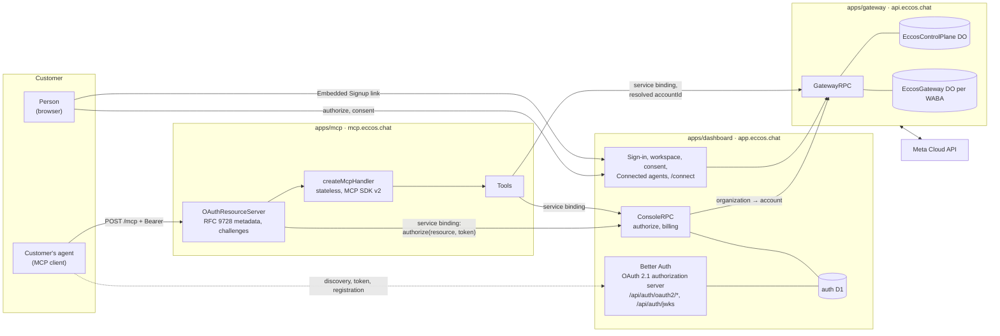
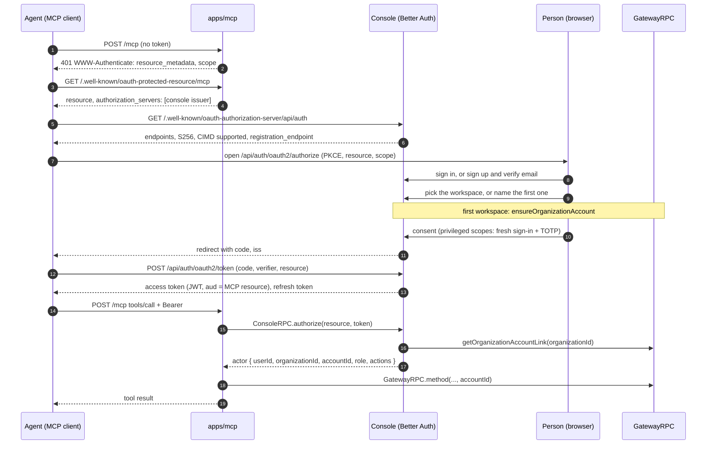

# Design: MCP server for agent-driven onboarding and management

Verified against primary sources on 2026-11-23; versions and URLs are in
[research.md](./research.md). Items marked **(spike)** were read in documentation but not run, and
are the first tasks in [tasks.md](./tasks.md).

## 1. Context the design must respect

Read from the repository at `3855943`:

- **Two planes, one authority each** (`docs/auth-tenancy-contract.md` §2). Better Auth on the auth
  D1 answers who is signed in and what role they hold; the `EccosControlPlane` Durable Object
  answers which account, WABAs, phones and keys exist. Neither answers the other's question.
- **Authorization is re-derived on every request** (§1, §5): session → membership →
  `organization_accounts` → account → WABA ownership. "No long-lived role claims (JWTs or
  otherwise) are ever trusted across requests", and a revoked membership takes effect on the next
  request.
- **One customer origin** (§6). The console answers only the `BETTER_AUTH_URL` host and accepts
  no credentials cross-origin.
- **The gateway's operator API is never public HTTP.** The console reaches it through the
  `GatewayRPC` service binding, passing an `accountId` it resolved itself.
- **Role matrix** (§4, `apps/dashboard/src/auth/permissions.ts`): `view` (viewer+), `operate`
  (operator+), `configure` and `administer` (admin+), `erase` (owner). Admin-class writes require
  TOTP and a sign-in within 15 minutes. That enforcement is PR #78, which is still open; today the
  policy is configured and not enforced.
- **The connection link already exists.** An admin mints a 7-day, single-use link bound to
  (account, creating user); whoever opens `/connect#<token>` runs Embedded Signup into that
  workspace with no Eccos session, in Spanish or English. This is exactly the hand-off an agent
  needs, and it is already audited and rate-limited.
- **Billing** (`apps/dashboard/src/billing`): Creem, priced per connected number. An account whose
  connect policy is `closed` cannot add numbers (`subscription_required`) but keeps sending.
- **Gaps in the gateway.** It only *reads* phone numbers from Meta. Nothing calls
  `POST /{waba}/phone_numbers`, `request_code`, `verify_code`, `register`, the two-step PIN,
  the display name or the business profile. Broadcasts and scheduled sends can be created only
  over public `/v1` with an API key; `GatewayRPC` reads and cancels them.

What changed upstream since the Captain's first sketch, and why it matters:

- **MCP is stateless as of revision 2026-07-28.** No `initialize`, no session id, no GET stream.
  Server-initiated requests became multi-round-trip results.
- **Cloudflare deprecated `McpAgent`** (the Durable Object per session) in `agents` 0.20.0. The
  recommended server is `createMcpHandler` from `agents/mcp/server` with MCP SDK v2: a fresh
  server per request, no Durable Object.
- **`@cloudflare/workers-oauth-provider` 1.x split into an authorization server and a resource
  server.** `OAuthResourceServer` takes a `validateToken` function, publishes RFC 9728 metadata
  and builds the Bearer challenges. Cloudflare's own split topology has the resource Worker call
  the authorization Worker over a service binding to validate a token.
- **Dynamic Client Registration is deprecated in the MCP spec** in favour of Client ID Metadata
  Documents (CIMD). Claude and ChatGPT support both; Cursor documents DCR.
- **Better Auth removed `oidcProvider` and the old in-tree `mcp` plugin in 1.7.0.** The current
  packages are `@better-auth/oauth-provider`, `@better-auth/mcp` and `@better-auth/cimd`, which
  require `better-auth` ^1.7.27. The repository pins 1.7.14.

## 2. Architecture



### 2.1 Components

**`apps/mcp` (new Worker).** A Hono app, like the gateway, with one job: speak MCP.

- `OAuthResourceServer` from `@cloudflare/workers-oauth-provider` hosts the resource
  `https://mcp.eccos.chat/mcp`. It serves `/.well-known/oauth-protected-resource/mcp`, answers a
  request without a valid token with `401` and a `WWW-Authenticate` challenge that carries
  `resource_metadata` and the scopes to ask for, and refuses a token whose audience is not this
  resource.
- Its `validateToken` is one call: `env.CONSOLE.authorize(resource, token)`. The MCP Worker never
  holds a signing key, never fetches a JWKS and never parses a claim it then trusts.
- `createMcpHandler` from `agents/mcp/server` serves Streamable HTTP at `/mcp`, stateless, with
  `legacy: "stateless"` so 2025-era clients work. There is no `/sse`, no Durable Object and no
  KV. The server factory registers only the tools the caller's effective permissions allow.
- Tools are plain functions of `(input, actor, { gateway, console })`, where `gateway` is
  `GatewayApi` and `console` is `ConsoleApi`. They never see the token.
- Bindings: `GATEWAY` (entrypoint `GatewayRPC`), `CONSOLE` (entrypoint `ConsoleRPC`), one Rate
  Limiting binding. Vars: its own public origin, the issuer URL, the console origin. No secrets.

**`apps/dashboard` (existing Worker) gains the authorization server.**

- Plugins: `jwt({ disableSettingJwtHeader: true })` with `disabledPaths: ["/token"]`,
  `mcp({ resource, loginPage, consentPage, postLogin, ... })` from `@better-auth/mcp`, and
  `cimd()`. `mcp()` *is* the OAuth provider; `oauthProvider()` is not registered next to it.
  `resourceSeedScope: "process"` because the auth instance is built per request.
- Issuer: `https://app.eccos.chat/api/auth`. The endpoints under `/api/auth/oauth2/*` and
  `/api/auth/jwks` are already reached by the existing `/api/auth/*` dispatch. The RFC 8414
  document lives outside that prefix, at `/.well-known/oauth-authorization-server/api/auth`, so
  `src/server.ts` serves it explicitly, before the page gate.
- Pages: the existing sign-in and sign-up, a workspace step (pick one, or create the first), and
  a consent page. Settings gains "Connected agents": the grants on this workspace, and Revoke.
- `ConsoleRPC`, a `WorkerEntrypoint` exported from the server entry **(spike: confirm the
  TanStack Start build keeps a named entrypoint export)**.

**`packages/console-contract` (new).** The `ConsoleApi` interface and its types, mirroring
`packages/gateway-contract`.

**`apps/gateway`.** Unchanged until phase 3. `apps/mcp` becomes its second trusted caller.

### 2.2 `ConsoleApi`

```ts
interface ConsoleApi {
  /** Verify the token for this resource and re-derive everything else. Never throws for a bad token. */
  authorize(resource: string, token: string): Promise<AuthorizeResult>;
  getBilling(actor: ActorRef): Promise<BillingState>;
  startCheckout(actor: ActorRef): Promise<{ url: string }>;
  openBillingPortal(actor: ActorRef): Promise<{ url: string }>;
  // phase 4: members and invitations
}

type AuthorizeResult =
  | { ok: true; actor: Actor; audience: string; expiresAt: number; scope: string[]; clientId: string }
  | { ok: false; reason: "invalid_token" | "revoked" | "not_a_member" | "no_account" };

interface Actor {
  userId: string;
  organizationId: string;
  accountId: string;
  /** The live role, read on this request. */
  role: "owner" | "admin" | "operator" | "viewer";
  /** Role actions ∩ scope actions. The only thing a tool checks. */
  actions: GatewayAction[];
  clientId: string;
}
```

`authorize` does, in order, on every MCP request:

1. Verify the JWT in process with the auth instance's own keys: signature, `iss`, `aud` equal to
   the resource, `exp`, `typ: at+jwt`, `azp` present. No network call and no key cache to go
   stale **(spike: the in-process verification entry point in 1.7.27)**.
2. Confirm the grant is still alive: the consent row for (user, client, workspace) exists. Revoking
   in "Connected agents" deletes it, so revocation takes effect on the next request rather than at
   token expiry.
3. Re-read membership of the workspace named in the token and the member's **current** role. Not
   a member: refuse.
4. Resolve `organization_accounts` through `GatewayRPC.getOrganizationAccountLink`. Anything but
   `active`: refuse.
5. Return the actor with `actions = roleActions(role) ∩ scopeActions(scope)`.

The reasons stay inside Eccos. The MCP Worker maps every refusal to the same `401` challenge, so a
token holder learns nothing about why.

### 2.3 Why this shape

**The token is a pointer, never evidence.** The contract forbids trusting role claims across
requests. A self-contained JWT validated at the edge of `apps/mcp` would carry a role for its
whole lifetime and could not be revoked before expiry. Asking the identity plane on each request
costs one RPC and a few D1 reads, which is what every console request already pays, and it makes
an agent's request go through the same six steps as a browser's (contract §1). Nothing about
authorization is cached in `apps/mcp`.

**Resource server and authorization server are different Workers on different hosts.** The
console's origin policy stays exactly as written: one host, cookies, no cross-origin credentials.
The MCP endpoint is the opposite kind of surface (bearer only, CORS-enabled, called by software),
and on its own hostname a browser never sends it an Eccos cookie, so there is no path by which a
session could authenticate an MCP call by accident.

**The MCP stack is isolated from the console.** Cloudflare ships `agents` roughly weekly and the
MCP SDK is on its second major version. Upgrades, rollbacks and rate limits for the agent surface
do not touch the console's bundle or its tests. Self-hosters who do not want it do not deploy it.

**Tools depend on two interfaces, not on a placement.** `GatewayApi` and `ConsoleApi` are the
whole dependency of the tool layer. Where the handler is mounted is a deployment detail that can
change without touching a tool.

**No state in the MCP layer.** Onboarding state already lives where it belongs: the connection
link and provisioning status in the control plane, the subscription at Creem. A tool that needs to
continue something takes an explicit handle (a `wabaId`, a template name), which is also what the
2026-07-28 spec prescribes in place of sessions.

### 2.4 Alternatives rejected

| Alternative | Why not |
|---|---|
| **Mount `/mcp` inside the console Worker.** | The least code: no new Worker, no `ConsoleRPC`, `requireMcpAuth` in process. Rejected because it puts a CORS-enabled bearer API on the cookie origin and amends §6's one-origin rule, couples console deploys to a fast-moving dependency, and lets tools reach into console internals instead of a declared interface. It remains a valid fallback: the tool layer would move unchanged. |
| **Put the MCP server in the gateway Worker.** | The gateway has no identity plane. It would have to learn users, roles and organizations, which is the coupling the two-plane split exists to prevent. |
| **`McpAgent` on a Durable Object.** | Deprecated and feature-frozen upstream, tied to MCP SDK v1 and protocol sessions the current spec removed. Nothing here needs a session. |
| **`apps/mcp` verifies the JWT itself against the console's JWKS and trusts its claims.** | The documented Better Auth path for a separate resource server (`createMcpProtectedRequestHandler`). Rejected because a role or workspace claim would be trusted for the token's lifetime, a revoked grant or membership would keep working until expiry, and it needs an HTTP fetch of the JWKS between two Workers on the same zone. It is the fallback if `ConsoleRPC` proves unworkable, with a 5-minute token lifetime. |
| **`apps/mcp` binds the auth D1 directly.** | Two Workers owning one identity store, and membership logic implemented twice. |
| **`OAuthAuthorizationServer` from Cloudflare as the issuer**, with Better Auth only as the upstream login. | A second token store in KV and a second consent model next to the one that already knows organizations. The owner asked for Better Auth as the issuer, and it supports everything the MCP profile needs. |
| **Account API keys as the MCP credential.** | The Captain's first sketch. Rejected by the owner; a key has no user, no role and no consent, and cannot be told apart per agent. |
| **Better Auth `agent-auth`.** | A different protocol (not OAuth) at 0.6.2 that its own docs call unstable. MCP clients speak OAuth. |

## 3. Authorization flow



### 3.1 What a token means

A token says: *this client may act as this user in this one workspace, within these scopes*.

- **One workspace per grant.** The post-login step stores the chosen workspace as the consent's
  reference id (`postLogin.consentReferenceId`), and `customAccessTokenClaims` copies it into the
  token. To work in another workspace, the agent connects again and the person picks it. No tool
  takes an organization or account id, so there is nothing to confuse.
- **Never more than the person.** Effective actions are the intersection of the live role and the
  granted scopes. A viewer who grants `eccos:administer` gets a token that can view.
- **Refused at issuance too.** `customAccessTokenClaims` throws when the user is no longer a
  member, which also ends refresh.

### 3.2 Scopes

Scopes mirror the role matrix, so there is one permission model to reason about, plus one scope
for the action that spends the customer's money with Meta and reaches real people.

| Scope | Allows | Role needed | Requested |
|---|---|---|---|
| `eccos:view` | Read status, numbers, templates, logs, billing state | viewer | By default |
| `eccos:operate` | Retry deliveries, cancel broadcasts and scheduled sends, read the webhook config | operator | By default |
| `eccos:send` | Send messages: test templates, text, broadcasts, scheduled sends | operator | By default |
| `eccos:configure` | Templates, webhook config, resubscribe, re-check a number, phone settings | admin | On demand |
| `eccos:administer` | Connection link, API keys, checkout, export | admin | On demand |
| `offline_access` | A refresh token | any | By default |

There is no scope for `erase`. A tool that needs a scope the token lacks answers with the MCP
scope challenge (`403`, `insufficient_scope`, the scopes it needs), and the client runs the
authorization again for the union. That is how an agent that started read-only asks for more, and
it puts a person in front of every escalation.

### 3.3 Step-up, moved to where a person is

The contract requires TOTP and a recent sign-in for admin-class writes. An agent cannot type a
TOTP code per call, and should not hold one. So the requirement moves to the moment of consent:

- Granting `eccos:configure` or `eccos:administer` requires the consenting session to satisfy the
  same policy as the console action (owner or admin with TOTP enrolled, signed in within 15
  minutes). Otherwise the consent page asks the person to re-authenticate first.
- A privileged grant is short. Access tokens live 10 minutes for every scope. Refresh for
  `view`/`operate`/`send` slides for 30 days; a grant that includes `configure` or
  `administer` ends 24 hours after consent, after which those tools answer with the scope
  challenge again **(spike: express this with `scopeExpirations` or per-grant refresh lifetime)**.
- This depends on PR #78 (TOTP and step-up enforcement) being merged first. Shipping privileged
  MCP scopes while the console itself does not enforce step-up would make the agent path the
  weaker one.

### 3.4 Client registration

Advertise both mechanisms, so that current and older clients connect:

- **CIMD** (`client_id_metadata_document_supported: true`, `none` among the token endpoint auth
  methods, `S256`). Claude and ChatGPT prefer it. Better Auth's `cimd()` requires an injected
  fetcher and ships one only for Node; its docs ask for DNS pinning that Workers cannot do. A
  Worker has no private network to be rebound into, so the Workers fetcher is: HTTPS only, the
  `global_fetch_strictly_public` compatibility flag, no redirects, a size and time cap **(spike)**.
- **DCR** (`allowDynamicClientRegistration` with unauthenticated registration) as the fallback
  that Cursor and 2025-era clients need. Registered clients get no default scopes beyond
  `eccos:view`, never skip consent, are rate-limited per address, and unused ones are deleted.

The consent page shows the client's name **and the host of its redirect URI**, because under both
mechanisms the name is chosen by whoever registered.

Better Auth's client administration endpoints (`/oauth2/create-client`, `/oauth2/get-clients`,
`/admin/oauth2/*`) have no caller in Eccos and are refused before dispatch, the same way the
organization endpoints are in `src/auth/blocked-endpoints.ts`.

### 3.5 A brand-new customer

There is no tool to sign up, because an MCP tool call needs a token and a token needs a user. The
authorization flow *is* the sign-up:

1. The person adds `https://mcp.eccos.chat/mcp` to their agent. The agent gets a `401`, discovers
   the console and opens the authorize URL.
2. No session: the sign-in page, with sign-up one click away (`signup.page`). They sign up and
   verify their email as today. The verification link returns them to the pending authorization
   **(spike: the signed authorization query lives 10 minutes; when it has expired, the agent
   simply connects again and the now-signed-in person lands on the next step)**.
3. No workspace: the post-login step is the existing onboarding form. Creating the workspace runs
   the existing `createOrganization` path, including `ensureOrganizationAccount`. No API key is
   issued, as the contract requires.
4. Consent, then the agent holds a token for that workspace.

From there the agent drives: `workspace_get` reports what is missing, `billing_checkout_link`
returns the Creem URL when a subscription is required, `connect_link_create` returns the
Embedded Signup link, `connect_status` and `numbers_list` follow provisioning, and the rest of
phase 1 finishes the setup.

The contract's §7 describes sign-up as invite-only for the initial release. No allowlist exists in
the code today and Eccos Cloud has been open to paying customers since 2026-11-12, so this design
assumes open, email-verified sign-up.

## 4. Tool inventory

Conventions: `snake_case`, noun first. Every tool declares an input and an output schema and
returns `structuredContent`. Read tools carry `readOnlyHint`; `template_delete`,
`api_key_revoke` and the cancels carry `destructiveHint`. Where an account has several WABAs or
phones, tools take `wabaId` and `phoneNumberId` and refuse ids the account does not own; with
exactly one, they default to it, as the console does. No tool takes an account or organization id.

"Scope" is the scope the token needs; the role needed follows from §3.2.

### Phase 1: connect and set up (no gateway change)

| Tool | Does | Scope | Backed by | Missing |
|---|---|---|---|---|
| `workspace_get` | Who the agent acts as, the workspace, role, granted scopes, and a setup checklist: subscription, numbers, webhook, API key, approved template | view | `authorize` result, `listAccountResources`, `getSubscriberConfig`, `listApiKeys` (count only), `listTemplates` | Nothing. The checklist mirrors `lib/setup-checklist.ts` |
| `billing_get` | Whether numbers can be added, connected numbers, monthly price | view | `billing/account.ts` `billingState` | `ConsoleRPC.getBilling` |
| `billing_checkout_link` | The Creem checkout URL, or the portal when a subscription exists | administer | `billing/account.ts` `checkoutUrl`, `portalUrl` | `ConsoleRPC.startCheckout`, `openBillingPortal` |
| `connect_link_create` | Mint the Embedded Signup link for a person to open; `replace` to supersede a live one | administer | `issueConnectLink` | Nothing. The token exists only in this result, as today |
| `connect_status` | Link state (pending, opened, connected, unconfirmed, expired) and the number it connected | view | `getConnectLink` | Nothing |
| `numbers_list` | WABAs and phones with provisioning status and error, coexistence state, token expiry | view | `listAccountResources` | Nothing |
| `number_recheck` | Re-run provisioning for a WABA stuck in pending or failed | configure | `reconcileWaba` | Nothing |
| `status_get` | Health and counters for a WABA | view | `getStatus` | Nothing |
| `webhook_get` | Subscriber URL, whether a secret is set, the last forward | operate | `getSubscriberConfig` | Nothing. The secret is never returned |
| `webhook_set` | Set the subscriber URL and secret | configure | `setSubscriberConfig` | Nothing |
| `webhook_resubscribe` | Redo the Meta webhook subscription | configure | `resubscribe` | Nothing |
| `api_keys_list` | Key ids, labels, created and revoked times | administer | `listApiKeys` | Nothing |
| `api_key_create` | Issue a key; returned once | administer | `issueApiKey` | Nothing. See open decision 5 |
| `api_key_revoke` | Revoke a key | administer | `revokeApiKey` | Nothing |
| `templates_list` | Templates with status, category, components | view | `listTemplates` | Nothing |
| `template_create` | Submit a template to Meta | configure | `createTemplate` | Nothing |
| `template_edit` | Edit a template | configure | `editTemplate` | Nothing |
| `template_delete` | Delete a template | configure | `deleteTemplate` | Nothing |
| `template_send_test` | Send an approved template to one recipient | send | `sendTemplateTest` | Nothing |

Phase 1 is everything needed for the full path with a number the customer brings through
Embedded Signup: connect the agent, subscribe, connect the number, point the webhook, issue a key,
get a template approved, send a test.

### Phase 2: observe and operate (no gateway change)

| Tool | Does | Scope | Backed by | Missing |
|---|---|---|---|---|
| `messages_list` | Inbound events and outbound messages, filtered and paged | view | `readInbound`, `readOutbound` | Nothing |
| `deliveries_list`, `delivery_get` | The forwarding queue | view | `listDeliveries`, `getDelivery` | Nothing |
| `delivery_retry`, `deliveries_retry_failed` | Retry one, or a window of failed forwards | operate | `retryDelivery`, `retryFailedDeliveries` | Nothing |
| `conversations_list`, `conversation_get` | Conversations and their messages | view | `readConversations`, `readThreadView` | Nothing |
| `message_send_text` | Free-form text inside the 24-hour window | send | `sendText` | Nothing |
| `broadcasts_list`, `broadcast_get`, `broadcast_cancel` | Read and stop broadcasts | view, operate | `readBroadcasts`, `readBroadcast`, `cancelBroadcast` | Nothing |
| `scheduled_list`, `scheduled_cancel` | Read and stop scheduled sends | view, operate | `readScheduled`, `cancelScheduled` | Nothing |

These tools return message content and phone numbers to the agent, and through it to the model
provider the customer chose. That is the customer's decision to make at consent, and the consent
page says so for `eccos:view`.

### Phase 3: phone-number management at Meta (new gateway capability)

| Tool | Does | Scope | Missing in the gateway and core |
|---|---|---|---|
| `number_get` | Quality rating, messaging limit, name status, verification status for one phone | view | Graph read of the phone number's fields; today only id and display number are read |
| `number_add` | Add a number the customer owns to a connected WABA | configure | `POST /{waba}/phone_numbers`; a control-plane row for a number that is not yet verified |
| `number_request_code` | Ask Meta to send the code by SMS or voice | configure | `POST /{phone}/request_code`, with a guard against repeated requests |
| `number_verify_code` | Submit the code the person received | configure | `POST /{phone}/verify_code` |
| `number_register` | Register the number for the Cloud API with a two-step PIN | configure | `POST /{phone}/register`; a decision on who chooses and who stores the PIN |
| `number_set_pin` | Change the two-step PIN | administer | `POST /{phone}` with `pin` |
| `number_set_display_name` | Request a display name change | configure | `POST /{phone}` with `new_display_name`; surfacing the review result |
| `business_profile_get`, `business_profile_set` | About, address, description, email, websites, picture | view, configure | `GET`/`POST /{phone}/whatsapp_business_profile`, media upload for the picture |

All of these belong in `packages/core` (pure Graph calls) and `GatewayRPC`, not in `apps/mcp`,
and the console can use them too. Two things to settle before building: whether the token that
Embedded Signup stores carries the permissions these writes need (**spike** on a test WABA), and
Meta's cap of two registered numbers on a new, unverified business portfolio, which `number_add`
must report before it tries.

### Phase 4: campaigns and team

| Tool | Does | Scope | Missing |
|---|---|---|---|
| `broadcast_create` | Send a template to a list | send | A `GatewayRPC` method; creation exists only on public `/v1` |
| `scheduled_put` | Schedule or replace a send | send | A `GatewayRPC` method; same |
| `message_send_template` | Send a template outside the test sheet | send | Possibly none: `sendTemplateTest` may serve, to be decided with its audit semantics |
| `members_list`, `member_invite` | The team | view, administer | `ConsoleRPC` methods over `src/members.ts`; an agent inviting people needs its own consent copy |
| `export_start` | Data export | administer | A delivery channel that does not pass an export through the model's context |

### Phase 5: obtaining numbers

Depends on the owner's decision in [number-purchase.md](./number-purchase.md).

### Never over MCP

`eraseByPhone`, organization deletion, ownership transfer, role changes, and anything that takes
an account id.

## 5. Security

Measured against `docs/threat-model.md`.

### 5.1 New assets

| Asset | Where it lives | Protection |
|---|---|---|
| OAuth access token | The agent, in transit | 10 minutes, audience-bound to the MCP resource, useless without a live grant, membership and account link |
| OAuth refresh token | The agent; hashed in the auth D1 | Rotating; replay of a rotated token revokes the family; ends with the consent row |
| JWT signing key | Auth D1, encrypted with `BETTER_AUTH_SECRET` | The session-JWT route (`/token`) is disabled so a session JWT cannot pass as an access token |
| Consent rows | Auth D1 | The revocation switch; shown in Settings |

`apps/mcp` itself holds none of them.

### 5.2 New trust boundary

**agent ↔ `apps/mcp`**, the fifth boundary. A caller is trusted for one request once
`ConsoleRPC.authorize` returns an actor. `apps/mcp` then joins the console as a caller of
`GatewayRPC` that supplies an `accountId`. The gateway's own ownership checks (WABA and phone
against the account) still run on every call, as they do for the console.

### 5.3 Threats

| Threat | Mitigation | Residual risk |
|---|---|---|
| Stolen access or refresh token | Short access lifetime, rotation with replay detection, per-request grant check, Revoke in Settings, privileged grants end after 24 hours | Until revoked, the thief acts as the user within the granted scopes in one workspace |
| Token replayed against another resource, or a session JWT presented as a token | `aud` must equal the MCP resource; `typ: at+jwt` and `azp` required; `/token` disabled | None known. Better Auth 1.7 recognises access JWTs by `azp`; nothing in Eccos signs custom JWTs |
| Confused deputy: the token forwarded onward | The token stops at `apps/mcp`. `GatewayRPC` receives an account id over a private binding, never a bearer | None |
| Cross-tenant access | No tool takes a tenant id; the account comes from the grant's workspace, re-resolved each request; the gateway re-checks WABA and phone ownership | The same as the console's, plus `apps/mcp` as a second place a bug could pass the wrong account. Covered by negative two-tenant tests per tool |
| Stale privilege after a role change or removal | Role and membership are read on every request | One request |
| Malicious or look-alike client (open registration) | Consent is never skipped; the page shows the redirect host; default scopes are read-only; registration is rate-limited | A person can still approve a client they should not. This is phishing, and the grant is visible and revocable |
| Prompt injection: a WhatsApp message tells the agent to act | Message-reading tools (phase 2) and writing tools use different scopes; privileged scopes are on demand and short; destructive tools are annotated so clients confirm; erasure is not exposed | **Real and not removable by Eccos.** An agent holding `view` and `send` that reads hostile inbound text can be talked into sending. Document it; recommend separate grants for reading conversations and for administration |
| Secrets in the model's context | `api_key_create` and `connect_link_create` return a secret by design; `webhook_set` receives one | The key or link passes through the agent and its provider. See open decision 5. Neither is ever logged |
| Spend and abuse through sends | `eccos:send` is its own scope; a per-user, per-client rate limit in `apps/mcp` | **(spike)** confirm whether RPC sends pass `SEND_RATE_LIMITER`, which today sits on the HTTP route |
| SSRF through CIMD fetches | HTTPS only, strictly public fetch, no redirects, size and time caps | Weaker than the DNS pinning Better Auth's docs ask for; a Worker has no internal network to reach |
| Subscriber URL SSRF | Unchanged: `webhook_set` goes through `setSubscriberConfig` and its existing validation | As today (DNS rebinding after save) |
| Flooding the public endpoints | Cloudflare edge; Rate Limiting binding on `/mcp`; Better Auth's rate limiter on the OAuth endpoints | `authorize` costs D1 reads per request. An unauthenticated request never reaches it: a missing or malformed bearer is refused in `apps/mcp` |
| Content or secrets in logs | Audit lines carry ids, tool name, client id and outcome only, following `server/audit.ts`; tool inputs and results are never logged | Convention plus types, as elsewhere |

### 5.4 Audit

Every mutating tool writes one audit line with the existing shape, extended by `via: "mcp"` and
`clientId`. The actor is the user, so an incident review reads the same whether a person or their
agent acted. Issuing a grant and revoking it are audited in the console.

### 5.5 Contract amendments this change requires

| Document | Amendment |
|---|---|
| `auth-tenancy-contract.md` §2, §11 | "API keys remain the only machine credentials" becomes: API keys remain the only *account* credentials. An OAuth grant is a delegated *user* credential, bounded by that user's live role in one workspace |
| §1 | The request-to-tenant flow gains a second entry: bearer token → `ConsoleRPC.authorize` → the same steps 3 to 6 |
| §4 | The matrix gains the scope column and the step-up-at-consent rule |
| §6 | The origin policy for pages and cookies is unchanged. The OAuth token, registration, JWKS and metadata endpoints answer cross-origin requests that carry no cookie |
| §9 | The inventory gains the OAuth endpoints, each with its policy, and the refused client-administration endpoints |
| `threat-model.md` | §1 assets, §2 the fifth boundary, a §3.5 for `apps/mcp`, the rows above in §4 |
| `PRODUCTION-READINESS.md` | `apps/mcp` as an artifact with its own claim |

Meta's App Review is not affected: the agent hands out the same connection link the console
does, so the reviewed connect path is unchanged.

## 6. Phasing

Each phase ships on its own and leaves the product coherent.

| Phase | Contents | Depends on | Outcome |
|---|---|---|---|
| 0. Groundwork | `better-auth` 1.7.14 → 1.7.27 with the re-checks its own comments call for; merge PR #78; the spikes | — | Advisories closed; step-up enforced; the unknowns in this design answered |
| 1. Connect and set up | Authorization server in the console, consent and workspace step, Connected agents, `ConsoleRPC`, `apps/mcp`, the 19 phase-1 tools, contract and threat-model amendments | 0 | An agent takes a customer from nothing to a tested number, with three human links |
| 2. Observe and operate | The phase-2 tools | 1 | An agent can run day-to-day operations and debug delivery |
| 3. Phone management | Core and gateway Graph calls, the phase-3 tools, the same actions in the console | 1 | An agent can add and register a number the customer owns, and manage its profile |
| 4. Campaigns and team | RPC methods for broadcasts and scheduled sends, members over `ConsoleRPC`, the phase-4 tools | 2 | Parity with the console for sending and team work |
| 5. Obtaining numbers | Per the owner's decision | 3 | See number-purchase.md |

**Recommended first delivery: phases 0 and 1.** It is the smallest thing that meets the stated
goal, it needs no new gateway capability, and all of its risk is in the authorization work, which
every later phase reuses unchanged.

## 7. Trade-offs accepted

- **An extra hop per request** (`apps/mcp` → `ConsoleRPC` → D1 and the gateway) in exchange for
  live authorization and instant revocation. The console Worker is already placed next to the D1
  primary for this reason.
- **A new Worker and a new contract package** in exchange for an unchanged console origin policy
  and an isolated dependency.
- **One workspace per grant** in exchange for tools that cannot address the wrong tenant. People
  with several workspaces connect once per workspace.
- **Scopes as coarse as roles** in exchange for one permission model. Finer scopes can be added
  later without breaking grants.
- **Privileged work needs a person every 24 hours** in exchange for keeping the step-up rule
  meaningful for agents.
- **DCR stays on** although the spec deprecates it, because clients that customers use today
  still need it.
- **Tool logic sits beside, not inside, the console's server functions.** Both call the same RPC
  methods. Any rule that today lives only in a server function moves down into `GatewayRPC` or
  `ConsoleRPC` before a tool exposes that operation; a tool never re-implements a console rule.

## Open decisions for the owner

| # | Decision | Recommendation |
|---|---|---|
| 1 | **How customers obtain new numbers.** Guidance and registration of a number they own (A), their own carrier account (B), Eccos as holder with Meta's pre-verified numbers (C), a carrier partnership (D). See number-purchase.md | A in phase 3, B as phase 5. Hold C until there is a legal opinion on CNMC, the carrier's resale terms, Creem's answer and a price |
| 2 | **Human steps beyond Embedded Signup.** Authorizing the agent is inherent to OAuth. The card at checkout is a pricing choice | Accept both. If a card-free start matters, let a new account connect its first number during the trial without a card; that is a billing change outside this spec |
| 3 | **How long an agent keeps admin rights.** Step-up at consent, then a privileged grant of 24 hours | 24 hours, and merge PR #78 before phase 1 ships privileged scopes |
| 4 | **Who may register as a client.** CIMD plus open DCR, or an allowlist of known clients | CIMD plus rate-limited DCR. An allowlist would lock out customers' own agents, which are the audience |
| 5 | **Returning a new API key in a tool result.** It passes through the agent and its model provider | Return it. The agent needs it to finish the setup, the person granted `administer` knowingly, and the consent copy says so. The alternative is a one-time reveal link in the console, which adds a fourth human step |
| 6 | **Placement and hostname.** `apps/mcp` at `mcp.eccos.chat`, or `/mcp` inside the console | `apps/mcp` at `mcp.eccos.chat` |
| 7 | **Reading conversations over MCP** (phase 2) sends message content to the customer's model provider | Ship it, behind explicit consent copy, and say so in `docs/privacy.md` |
| 8 | **Self-hosting.** Whether `apps/mcp` is documented for self-hosters in the first release | Ship it for Eccos Cloud first; document self-hosting once phase 1 is stable |
